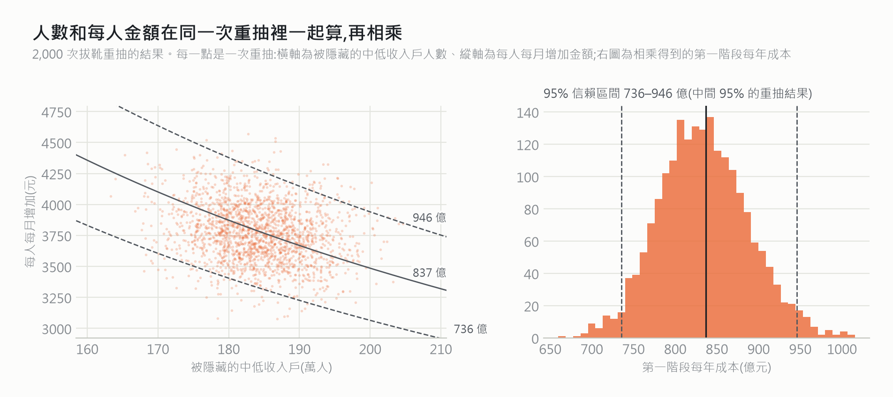

# 拔靴法說明：被隱藏的中低收入戶與兩階段成本的信賴區間怎麼算

報告推估約 **185 萬名**沒有按月年金的長輩，依收入符合中低收入老人生活津貼卻沒有領到（95% 信賴區間 171–197 萬）；讓他們改領津貼，第一階段每年要多 **837 億元**（736–946 億）；改領後仍不足最低生活費的部分，第二階段每年再加 **555 億元**（476–642 億）。這份文件一步一步說明這些區間怎麼來、為什麼這樣做，以及它的限制。對應程式是 [`pension/estimate.py`](pension/estimate.py) 的 `hidden_poor()` 與 `bootstrap_fn()`。

---

## 1. 要估的是什麼

第一階段成本可以拆成兩個估計值相乘：

$$
C_1 \;=\; \underbrace{N\cdot \hat p}_{\text{被隱藏的人數}} \times \underbrace{\hat g}_{\text{每人每月增加}} \times 12
$$

- $N$:65 歲以上人口 457 萬人（內政部，2025 年 6 月底）。
- $\hat p$：加權後，65 歲以上長輩中「沒有按月年金、依收入符合津貼資格、卻沒有領補助」的比例（40.4%，即 185 萬人）。
- $\hat g$：這些人改領津貼後，每人每月平均增加的錢（3,777 元）。因為津貼只能和國民年金、老農津貼擇一，這是扣掉原本津貼後的差額。

$\hat p$ 和 $\hat g$ 都是從 862 位長輩（1,500 人次）算出來的**估計值**。換一批人調查，兩個數字都會不一樣。信賴區間要回答的是：**因為「剛好抽到這批人」，成本可能會差多少？**

## 2. 為什麼不直接套公式

1. **成本是兩個估計值相乘**。乘積的誤差沒有簡單的公式，只能用近似（delta method，見第 6 節）。
2. **同一個人出現兩次**。1,500 人次來自 862 人，同一人 2022、2024 年的資料不獨立，公式會把誤差算得太小。
3. **PSFD 不是簡單隨機抽樣**。它是先抽鄉鎮、再抽人（見第 3 節），同一鄉鎮的人比較相似。
4. **每人金額來自複雜的規則**。是否符合資格、領哪一級津貼、要放棄多少原本的津貼，都是分段規則，沒有現成的變異數公式。

拔靴法（bootstrap;Efron, 1979）不需要推導公式，而是讓電腦**模擬「重新做很多次調查」**，直接看估計值會晃動多少。

## 3. PSFD 原本是怎麼抽樣的

依中央研究院調查研究專題中心的說明：

- **抽樣底冊**：戶籍資料中符合出生年次的臺灣居民。
- **抽樣方法**:**分層多階段隨機抽樣**。先把臺灣分成 9 個區域（分層），在每個區域內隨機抽出**鄉鎮市區**；抽中的鄉鎮再抽出**村里**；最後在村里中依戶籍抽出受訪者。

所以資料的「基本單位」不是一個一個人，而是**一個一個被抽中的鄉鎮**。

## 4. 我們的拔靴法：模仿原本的抽樣

原則是**「怎麼抽來的，就怎麼重抽」**。

| PSFD 原本的抽樣 | 本研究的重抽 | 為什麼不完全一樣 |
|---|---|---|
| 分層：9 個區域 | 分層：**縣市**（21 個） | 公開資料沒有提供原始分層代碼；縣市比 9 區更細 |
| 第一階段：鄉鎮市區 | 抽樣單位：**鄉鎮市區**（以郵遞區號代表，123 個） | 公開資料沒有提供原始抽樣單位，用現住地近似 |
| 第二、三階段：村里、個人 | 不另外重抽 | 抽到一個鄉鎮，就把裡面**所有人、所有年份**一起帶進來 |

同一人如果兩年住址不同，一律用第一次出現的地址，確保同一人永遠屬於同一個鄉鎮。

### 步驟

設縣市 $h$ 有 $n_h$ 個鄉鎮。每一次重抽（第 $b$ 次，$b = 1, \dots, 2000$）：

1. **在每個縣市內**，有放回地抽出 $n_h$ 個鄉鎮。同一鄉鎮可能被抽到兩次，也可能沒被抽到。
2. 把抽到的鄉鎮裡的所有資料列合併，成為一份「模擬的新樣本」。
3. 依這份新樣本**重新計算事後加權的權數**（第 5 節）。
4. 用**同一份新樣本、同一組權數**，依報告 2.3 節的公式重新判斷每個人是否被隱藏、能增加多少，同時算出人數、每人金額、第一階段與第二階段成本。
5. 重複 2,000 次。
6. 取第 2.5 與第 97.5 百分位數，就是 95% 信賴區間（百分位法）。

亂數種子固定為 2026，每次執行結果都一樣。

```python
# pension/estimate.py 的 bootstrap_fn()
for _ in range(n_boot):
    parts = []
    for st, ps in strata.items():                                   # 每個縣市(分層)
        parts += [psu_rows[p] for p in (ps if len(ps) == 1 else rng.choice(ps, len(ps)))]
    b = pd.concat(parts, ignore_index=True)
    boot.append(fn(b, weights(b)))                                  # 重算權數;人數、每人金額、成本一起算
```

## 5. 為什麼每次都要重算權數

樣本的年齡、性別組成和全國不同，所以用**事後分層加權**校正（65–74 / 75+ × 性別，4 格）：

$$
w_i = \frac{\text{全國人口中第 } c(i) \text{ 格的比例}}{\text{樣本中第 } c(i) \text{ 格的比例}}
$$

每次重抽的樣本組成都會改變，權數必須**在每次重抽裡重算**，否則等於假設權數沒有誤差。重算的效果是讓每一份模擬樣本都重新校準到全國的年齡 × 性別結構，所以區間會比權數固定時**稍窄**（第 7 節）。

## 6. 人數和每人金額必須在同一次重抽裡一起算

**正確做法**（本研究）：每一次重抽，用同一份樣本同時算出人數 $N\hat p^{*}_b$ 和每人金額 $\hat g^{*}_b$，當場相乘，最後才對 2,000 個成本取百分位數。

**錯誤做法**：分別算出人數的區間（171–197 萬）和每人金額的區間（3,336–4,250 元），再把**端點相乘**:

$$
171\text{ 萬} \times 3{,}336 \times 12 \approx 687\text{ 億},\qquad 197\text{ 萬} \times 4{,}250 \times 12 \approx 1{,}005\text{ 億}
$$

得到 687–1,005 億，比正確的 **736–946 億寬了約一半**。錯在它假設「人數剛好最少」和「每人金額剛好最少」會同時發生。



左圖每一點是一次重抽，曲線是「成本相同」的組合；右圖是 2,000 個第一階段成本的分布。

**兩者是負相關（−0.22）**：重抽到符合資格的人比較多時，每人平均增加的金額往往比較低（新增進來的多半是收入接近門檻、差額較小的人）。這個相關讓兩種誤差部分抵銷，所以：

1. 如果分開各跑一次拔靴法，再把兩組結果**隨機配對相乘**，會忽略這個抵銷，得到 724–954 億，**比正確結果寬**。
2. 只有在同一次重抽裡一起算，才能正確反映兩者的相關。

**用 delta method 驗算**:

$$
\frac{\text{SD}(C_1)}{C_1} \approx \sqrt{\left(\frac{\text{SD}(\hat N)}{\hat N}\right)^2 + \left(\frac{\text{SD}(\hat g)}{\hat g}\right)^2 + 2\rho\,\frac{\text{SD}(\hat N)}{\hat N}\frac{\text{SD}(\hat g)}{\hat g}}
= \sqrt{0.0346^2 + 0.0620^2 + 2(-0.215)(0.0346)(0.0620)} = 0.0642
$$

$0.0642 \times 837 = 53.7$ 億，與拔靴法直接算出的標準差 53.6 億幾乎一樣；若忽略相關（$\rho=0$），會高估為 59.4 億。

## 7. 不同做法的比較

| 做法 | 被隱藏的人數（萬） | 每人每月增加（元） | 第一階段（億/年） | 第二階段（億/年） |
|---|---|---|---|---|
| 點估計（加權） | 185 | 3,777 | 837 | 555 |
| **縣市內重抽鄉鎮、每次重算權數（報告採用）** | **171–197** | **3,336–4,250** | **736–946** | **476–642** |
| 以人為單位重抽、每次重算權數 | 172–198 | 3,496–4,075 | 753–920 | 492–622 |
| 縣市內重抽鄉鎮、權數固定不重算 | 165–204 | 3,333–4,251 | 714–960 | 457–670 |
| Rao–Wu 修正（縣市內抽 $n_h-1$ 個鄉鎮） | 171–198 | 3,274–4,298 | 723–957 | 475–645 |
| ✗ 人數與每人金額的端點相乘 | — | — | 687–1,005 | — |
| ✗ 分開重抽再隨機配對 | — | — | 724–954 | — |

**怎麼讀這張表**

- **以鄉鎮重抽 vs 以人重抽**：以鄉鎮重抽的區間較寬，代表同一鄉鎮的長輩收入相近、彼此相關；忽略這點（以人重抽）會讓區間太窄。所以報告採用以鄉鎮重抽。
- **權數重算 vs 固定**：重算較窄，原因見第 5 節。
- **Rao–Wu 修正**：縣市內鄉鎮很少時，有放回地抽 $n_h$ 個會讓變異數略為少估。Rao & Wu（1988）改抽 $n_h-1$ 個、權數乘上 $n_h/(n_h-1)$，區間略寬（723–957 億），結論不變。

## 8. 限制

拔靴法只回答「**抽樣運氣**造成的誤差有多大」，不會讓估計更準，也不能變出樣本裡沒有的人。

| 可以處理 | 不能處理 |
|---|---|
| 人數 × 每人金額這類複雜計算的誤差 | 樣本沒涵蓋的人：90 歲以上、住在機構的長輩 |
| 同一人出現兩年、同一鄉鎮的人彼此相似 | 資產審查：問卷沒有存款與房產，寬鬆估計無法扣除超過門檻者 |
| 加權本身的誤差 | 回答本身的誤差，例如收入少報 |

其他近似：

- **分層與抽樣單位是近似的**：用縣市代替原始的 9 區分層、用現住地郵遞區號代替當初被抽中的鄉鎮。
- **只有一個鄉鎮的分層**：嘉義市、新竹市、苗栗縣在樣本中只有一個鄉鎮，地址不明者也自成一組；無法在分層內重抽，每次都原樣保留，不貢獻變異。
- **外部數字視為固定**:457 萬人、最低生活費與津貼金額都視為精確。

## 參考文獻

- Efron, B. (1979). Bootstrap methods: Another look at the jackknife. *The Annals of Statistics*, 7(1), 1–26.
- Efron, B., & Tibshirani, R. J. (1993). *An Introduction to the Bootstrap*. Chapman & Hall.
- Rao, J. N. K., & Wu, C. F. J. (1988). Resampling inference with complex survey data. *Journal of the American Statistical Association*, 83(401), 231–241.
- 中央研究院人文社會科學研究中心調查研究專題中心，華人家庭動態資料庫（PSFD）資料說明。
